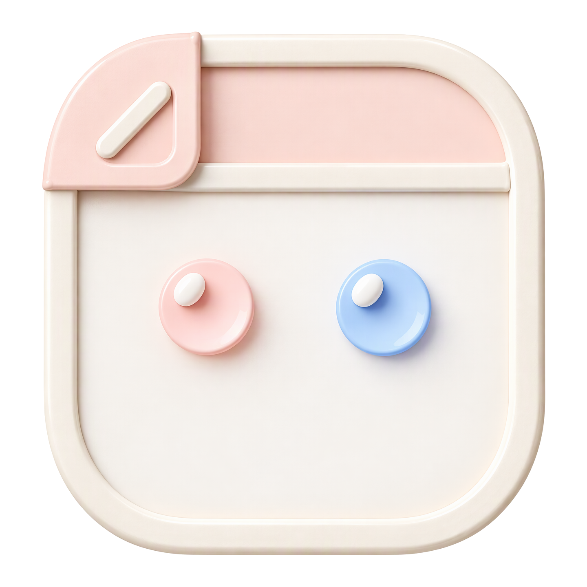

<p align="center">
  
</p>
<h1 align="center">Mico</h1>
<p align="center">一个本地优先的画布，让人与 AI Agent 共同创作。</p>
<p align="center"><a href="docs/README.en.md">English</a></p>

## 这是什么

Mico 是一个本地优先的画布实验：人和本地 Agent 编辑同一批画板。浏览器负责渲染画布，守护进程管理一组命名画布并存入 SQLite，CLI 与 HTTP API 让 Agent 能完整访问同一批画布和同一套操作。

它是一台机器上的本地画布集合，不是多人服务器。除了限制浏览器来源和主机之外没有其他鉴权，本机运行的进程都被视为可信；不要把守护进程暴露到网络。调整尺寸、远程部署和 MCP 尚未实现。实时麦克风采集需要所选服务的凭据和代理；Chat 与 MAI 绘制依赖已配置的 AI 网关，MOSS Live 用自己的语音模型和原生工具调用。

## 功能

画布支持多个命名画布、平移、缩放、矩形、椭圆、排版文字、直线、自由笔刷、便签、图片、框、HTML 卡片、连接线、拖动、吸附、框选、配色和删除。画板首次加载时适配视口；点 Fit 或按 F 可再次适配全部对象。

The bottom-left minimap and canvas-list previews share a block-only overview: notes, rectangles, ellipses, frames, HTML cards and images contribute silhouettes; standalone text, lines, connectors and strokes are ignored, including their bounds. No labels, HTML or image bytes are embedded. Click or drag the minimap to navigate, or focus it and use the arrow keys. It shows the visible viewport, accounts for the open assistant, and hides at widths of 980px or less.

The toolbar's Undo and Redo retain the last 20 successful manual edits per canvas in browser memory. A completed gesture or property submission is one step; pan/zoom and external AI/API edits are not recorded. Switching canvases retains each history; reloading clears them. A new edit clears redo. Use Cmd/Ctrl+Z to undo, Cmd/Ctrl+Shift+Z or Ctrl+Y to redo; text inputs retain native editing shortcuts. Undo restores deleted connectors, frame membership, image backgrounds and stacking order. Unrelated external edits survive; conflicting changes to affected objects block replay with a notice instead of overwriting them. History does not cover canvas creation, renaming or deletion.

Logo 旁的 Canvases 按钮打开面板，列出每个画布的名称、最后更新时间和生成的预览。可在面板里创建、切换、重命名和删除画布。活动画布由所有已连接的浏览器、API 和 CLI 共用，Agent 可以把工作留在一个画布上，人再切过去看。最后一个画布不允许删除。切换画布会清除临时选择并重新适配画板，刷新页面仍保持当前画布。

用 Select 在空白处拖动可框选多个对象，按 Delete 会原子删除。Frame Selection 会把当前选择包进一个带 32px 内边距的命名容器。框只是容器：不能嵌套另一个框，不会成为普通图形的连接线端点，框体本身不可点击。通过左上角的标签选中并拖动它，成员会一起移动。在框内完整绘制图形、直线、笔刷、便签或 HTML 卡片会自动成为成员，把对象拖入框内会加入，完整拖出则脱离。删除框会释放成员，不删除内容。Sticky notes (N) support multiline text and seven palette choices. Text (T) supports Hand, Serif, Sans and Mono, sizes 16/18/24/32/48px and weights 300/400/500/600/700.

图片工具（I）上传本地 PNG、JPEG、WebP 或 GIF，最大 10 MiB，并放到画布上。每个画布最多有五个图片形状，上传和 AI 生成的都算在内。图片字节与画布形状分开存放在本地 SQLite 里，由守护进程提供读取；画布同步只传素材 ID。选中框的标签后可以把已有图片设为背景，并选择 Cover（裁切）、Contain 或 Stretch。图片仍是独立的形状；删除它会清掉所有引用它的框背景。形状被删除后，上传的素材仍留在数据库里。画布列表的预览用图片占位符，不嵌入素材本身。

HTML 卡片工具（W）先创建空卡片，再由 Agent 通过批量 API 填入内容。卡片里的 sandbox iframe 内联了 Bootstrap 5 的 CSS 和 JavaScript，可渲染内联 HTML、CSS、脚本和 data-URI 图片。沙箱不授予同源权限，内容安全策略会阻止外部资源。这个原型开启了脚本执行，不受信任的脚本仍可能占用浏览器资源。通过左上角的标题选中卡片才能操作控件，也可以拖标题移动它。卡片是叶子节点：可以放进框，但不能包含其他对象。界面上只能改标题，标记内容要通过 API 修改。 The rounded shell does not clip the sandboxed iframe, so saved content remains visible at its corners.

选中笔刷工具（P）后拖动即可绘制。工具栏提供铅笔、马克笔和收尖笔刷三种笔触，以及 2/4/8px 三种宽度。 The default is a 4px grape pencil stroke.笔画保存为 `path` 形状，选中后仍能改笔触、宽度和颜色。AI Agent 通过批量 API 创建同样的形状；[`examples/sketch.ts`](examples/sketch.ts) 用 23 笔收尖笔触画出房子、火柴人、太阳和山丘。选中手形工具或按住空格拖动可平移画布。画连接线时选连接线工具，从源节点拖向目标节点。框只连框，普通对象只连普通对象；靠近时兼容节点会显示锚点，高亮的锚点就是实际保存的附着点。选中连接线后可以拖动任一端点到另一个兼容节点；落在空白处、取消指针操作或按 Escape 都保持原状。属性面板里的 Source 和 Target 控件提供键盘操作方式。提交一次拖动前会检查并发的 Agent 编辑。

Dragging an object snaps its origin to a 16px world-space grid and aligns left/right/center or top/bottom/middle with nearby objects within six screen pixels. Matching alignments show dashed guides and take precedence over grid snapping on that axis. Objects farther than 160 screen pixels do not attract.

Canvas objects retain the candy palette in [`src/web/design.ts`](src/web/design.ts); the surrounding frame uses the glass and jelly tokens in [`src/web/frame/tokens.css`](src/web/frame/tokens.css). The canvas has an animated aurora, subtle grain and a world-aligned dot grid: its visual spacing is 24 world units at 100% zoom and adapts to stay legible while zooming. This visual grid is distinct from the 16-unit snapping grid. Reduced-motion preferences stop the aurora animation.

身份面板放 Logo 和 Canvases 按钮。右上角单独的 AI 按钮带呼吸状态灯，点开是停靠在右上角的助手面板，图标分页为 Chat、Live、Audio 和 Settings。Chat 通过 Vercel AI SDK 从本地 Magpie 网关流式读取回复；每条消息都是一次画布回合：助手读取画板和当前框选，调用绘图工具，回复流式输出的同时画板实时更新。指令要求增量工作——先写标题和核心对象，查看画板，再调整和扩展，而不是一次倾倒整个批次——所以一堂科学课会一步步出现。空画板提供快速课程提示，`?ai=<prompt>` 会打开面板并立即提交该提示，便于脚本化测试。Audio 播放预录会话。Live 采集麦克风语音，默认 MOSS Live，也可选 MAI 转写。底部工具栏固定在屏幕空间，选中对象的属性在右侧面板；窄视口会把属性面板移到工具栏上方并让控件换行，而不是裁掉。画布平移和缩放不会改变这些面板的尺寸或位置。控件固定 40px 高、20px 图标、14px 文字，间隔按四像素栅格：工具栏内边距、间隙、分隔线、属性列和选择内缩都是四的倍数。工具栏按内容定宽，按钮之间留四像素。功能图标统一用 Lucide，快捷键提示只在悬停时出现；工具栏支持方向键移动焦点、Enter 选中工具。浏览器页面缩放由 viewport 锁和键盘/手势拦截禁用，画布缩放独立保留。

### AI 网关

助手使用兼容 OpenAI 的 Chat Completions API。打开 **AI → Settings** 设置端点、模型和 API Key。改动在下一次请求生效，并保存到 `~/.config/mico/settings.json`（仅所有者可读写）。密钥以明文存在本机，不会返回给浏览器。密钥输入框留空表示保留当前值，也可以选 **Remove current API key** 让后续请求不带密钥。远端端点请用 HTTPS。

在保存设置之前，守护进程读取以下环境变量和默认值：

| 变量              | 默认值                     | 用途                                 |
| ----------------- | -------------------------- | ------------------------------------ |
| `MAGPIE_BASE_URL` | `http://127.0.0.1:3425/v1` | 网关地址，包含 `/v1`。               |
| `MAGPIE_MODEL`    | `auto/gpt-6-luna`          | 发给网关的模型 ID。                  |
| `MAGPIE_API_KEY`  | `magpie`                   | Bearer token；设为空字符串则不发送。 |

已保存的设置优先于环境变量。网关不可达时，面板会给出可操作的错误信息和 Continue 按钮。助手只能操作画布，不是通用聊天端点。

助手还可以用 `gpt-image-2.5-flare` 生成相关图片。生成异步进行，一次只处理一张；结果放回原画布，不覆盖已有对象，也可以用作框背景。守护进程从环境读取 `AZURE_OPENAI_ENDPOINT` 和 `AZURE_OPENAI_API_KEY`；图片提示词发往 Azure，可能产生费用。底层脚本从标准输入读取 `{prompt, aspect}` JSON，`aspect` 支持 `1:1`、`3:2`、`2:3`，并把 PNG 字节写到标准输出。

### 实时会话模式

Live 默认用 MOSS Live 全双工语音，也可以选 **MAI Transcribe**，走最初的麦克风转写加 AI 绘图流程。麦克风权限只在开始录音时申请；停止录音、切换服务、离开 Live 或关闭面板都会释放麦克风。

MOSS 接收麦克风音频和当前画布上下文，一边说话一边直接调用已有的画布工具。工具结果在执行完成后才返回给 MOSS；画布版本冲突时需要重新读取画板。MOSS 会话使用只在服务端的 `MOSS_API_KEY`（来自 `.env`），连接期间计费。Audio 分页通过 Azure `MAI-Transcribe-2-Streaming` 播放录音；MAI Live 同样把已确认的转写片段发给配置好的 AI 网关。

- [`src/web/stt/`](src/web/stt/) 放 PCM 重采样、WebSocket 客户端和基于能量的静音切分。音频模式默认静音一秒，等一个停顿再切，而不是在 15 秒时硬切断连续语音；静音阈值可在面板调整。MAI 麦克风模式保留 500ms 默认值和 15 秒上限。
- [`src/server/mossProxy.ts`](src/server/mossProxy.ts) 把 `/moss` 代理到 MOSS，并在服务端完成授权；[`src/server/mossApi.ts`](src/server/mossApi.ts) 通过本地守护进程暴露经过校验、绑定画布的原生工具。密钥不会发到浏览器。
- [`src/server/maiProxy.ts`](src/server/maiProxy.ts) 是 Vite 的 WebSocket 代理，负责附加 Azure `api-key` 头；它提供 `/mai/config` 并代理 `/mai/realtime`。
- `.env` 为 MOSS 提供 `MOSS_API_KEY`，为 MAI 提供 `AZURE_MAI_HOST`、`AZURE_OPENAI_API_KEY` 和 `AZURE_OPENAI_DEPLOYMENT`。把 [`.env.example`](.env.example) 复制成 `.env` 后填入这些值；`.env` 已被 Git 忽略。
- [`public/evals/`](public/evals/) contains generated session MP3s and `manifest.json`: ten school lessons, ten meeting/planning cases, and a Microsoft earnings outlook briefing. Scripts, catalog, and the briefing's sources are in [`evals/cases/`](evals/cases/).
- Live 面板包含带提交标记的波形、实时确认/假设文本、VAD 能量表、播放速度、静音阈值、每段延迟、`New canvas` 按钮和 `Create session summary` 操作。讲者进入收尾时，AI 可以生成可视化 HTML 摘要；会话结束、队列排空后会再次要求创建或更新同一张卡片。AI 生成的 HTML 可以内联支持的 Lucide 图标 SVG，沙箱策略不变。
- AI 会把已有的相关对象分组进框，成员变大时扩展框边界，并拒绝与无关内容重叠的扩展。手动编辑框仍按原行为处理。实时内容可以延伸到画布之外，不受初始视口限制。
- `New canvas` 创建并激活一个命名画布，让一堂课从空画板开始。AI 队列保持串行：一次只处理一个课堂请求，落后时最多合并三个待处理片段。片段不完整或没有新的可视化事实时可以只返回 `WAIT`；这类回复渲染成一个小的等待标记，不绘图。
- `?ai=<prompt>` 仍会打开聊天并立即提交，供脚本化测试使用。

## 使用

### 环境要求

- Node.js 24 或更新版本
- pnpm

### 启动

```sh
pnpm install
pnpm daemon
```

另开一个终端：

```sh
pnpm dev
```

打开 <https://mico.dev.hexly.ai/>。Caddy 把请求代理到 `127.0.0.1:7063` 的 Vite；Vite 把 `/api`（含 WebSocket 升级）代理到只监听回环地址的 `127.0.0.1:37063` 守护进程。浏览器始终用同源 HTTPS/WSS，不会向回环地址发混合内容请求。所有画布保存在 `.mico/board.sqlite`；旧的单画板版本创建的数据库会在首次启动时迁移成名为「My canvas」的画布。

### Agent CLI

命令把 JSON 写到标准输出，错误写到标准错误并返回非零退出码。CLI 直连本地守护进程，不经过模型服务或云服务。

```sh
node src/cli/index.ts canvas list
node src/cli/index.ts canvas list --preview
node src/cli/index.ts canvas create --name "Research" --use
node src/cli/index.ts canvas use <id>
node src/cli/index.ts canvas rename <id> "New name"
node src/cli/index.ts canvas delete <id>
node src/cli/index.ts canvas get <id>
node src/cli/index.ts board get
node src/cli/index.ts board get --canvas <id>
node src/cli/index.ts shape create '{"type":"rectangle","x":100,"y":100,"w":180,"h":80,"color":"#5b5fc7","text":"Hello"}' --canvas <id>
node src/cli/index.ts shape update <id> '{"x":300,"y":200}'
node src/cli/index.ts shape delete <id>
node src/cli/index.ts batch examples/architecture.json --canvas <id>
node examples/distributed-architecture.ts | node src/cli/index.ts batch -
node examples/sketch.ts | node src/cli/index.ts batch -
```

画布和形状命令默认作用于活动画布。`--canvas <id>` 可以指定其他画布而不切换当前画布，返回结果里仍带那张画布的画板。`canvas list` 默认省略体积较大的预览 data URL，加 `--preview` 才输出。

分布式电商示例会在原 Mico 图右侧加上 20 个服务和客户端、27 条连接线、六个标题，且不删除已有对象。它使用固定的 `commerce-` 前缀 ID，重复应用会原子失败。应用到已打开的画板后点 Fit 查看。

`shape create` 省略 ID 时会自动生成。批次是 `create`、`update`、`delete` 操作的数组；用 `-` 代替文件名可从标准输入读取 JSON。批量创建的形状必须自带 ID，连接线才能引用。示例使用固定 ID，只能对空画板应用一次。删除形状会连带删除附着其上的连接线；连接线两端必须是不同对象。

图片要先上传，再用返回的素材 ID 创建形状。框背景引用的是形状 ID，不是素材 ID：

```sh
curl -X POST -H 'Content-Type: image/png' --data-binary @photo.png http://127.0.0.1:37063/api/images
node src/cli/index.ts shape create '{"id":"photo","type":"image","imageId":"<uploaded-id>","x":100,"y":100,"w":320,"h":240,"color":"#1a1a1a"}'
node src/cli/index.ts shape update <frame-id> '{"backgroundImageId":"photo","backgroundFit":"cover"}'
```

画布形状包含 `id`、`type`（`rectangle`、`ellipse`、`text`、`line`、`note`、`path`、`frame`、`html`、`image`）、`x`、`y`、`w`、`h`、`color`（六位十六进制）以及可选的 `text`。直线的 `w` 和 `h` 是指向端点的带符号偏移。`image` 通过 `imageId` 引用已上传素材，也可以成为框成员。`frame` 必须有非空 `title`（最多 120 字符），没有 `frameId`，不能嵌套；可选的 `backgroundImageId` 引用同一画布上的图片形状，`backgroundFit` 为 `cover`（默认）、`contain` 或 `stretch`，把 `backgroundImageId` 设为 `null` 可清除背景。`html` 卡片必须有 `title` 和 `html`（最多 200 000 字符），可以带 `frameId` 放进框里。普通形状和卡片都可以带 `frameId` 指向已有的框，且只能指向框。连接线有 `id`、`type: "connector"`、`from`、`to` 两个形状 ID 和 `color`；两端必须同为框或同为普通对象。`path` 形状有 `points`（相对 `x`/`y`、位于 `w`/`h` 范围内的 2–4096 个点）、`brush`（`pencil`、`marker`、`brush`）和 `strokeWidth`（1–64）。路径与其他形状共用锚点、拖动和吸附。越界点或未知笔刷会让整批操作原子失败。可选的 `fromAnchor` 和 `toAnchor` 把端点固定到确切的锚点序号：方框/文字/便签/HTML 卡片/框有 12 个锚点，直线有 5 个。序号必须是对应节点范围内的非负整数，非法值会让整批操作失败。未固定的端点自动选择最近的外侧路径，固定后的附着点会随节点移动。

### 守护进程 API

- `GET /api/live` — 状态和从清单读取的版本号。
- `GET /api/state` — 活动画布的 `{stateVersion, activeCanvasId, canvases, board}`，适合 Agent 和初次加载。轮询时加 `?previews=0` 可省略摘要里的预览。
- `GET /api/canvases` — `{stateVersion, activeCanvasId, canvases}`。每条摘要含 `id`、`name`、`revision`、`createdAt`、`updatedAt` 和一个受限的 160×100 SVG data-URL `preview`；加 `?previews=0` 可省略预览。
- `POST /api/canvases` — `{name?, activate?}`；返回更新后的状态以及 `createdCanvasId`。
- `GET /api/canvases/:id` — 单个画布的 `{canvas, board}`。
- `PATCH /api/canvases/:id` — `{name}`；返回更新后的状态。
- `DELETE /api/canvases/:id` — 删除画布并返回更新后的状态。删除最后一个画布会被 `LAST_CANVAS` 拒绝。
- `PUT /api/active-canvas` — `{id}`；切换共享的活动画布并返回更新后的状态。
- `GET /api/board` — 活动画布的 `{revision, shapes}`。
- `POST /api/images` — 上传 PNG、JPEG、WebP 或 GIF 原始字节，需带匹配的 `Content-Type`，最大 10 MiB；返回 `{id}`。`GET /api/images/:id` 读取已存字节。不会抓取远端图片 URL。
- `POST /api/operations` — `{operations, expectedRevision?, canvasId?}`；默认作用于活动画布，也可以指定其他画布而不切换。返回该画布的画板。
- `GET /api/ai/settings` / `PUT /api/ai/settings` — 读取或更新 `{baseURL, model, apiKey?}`。读取结果只返回 `{baseURL, model, hasApiKey}`，不含密钥；更新时省略 `apiKey` 表示保留，传空字符串表示移除。
- `GET /api/ai/models` — `{models: string[]}`。用服务端密钥访问当前生效 `baseURL` 下兼容 OpenAI 的 `/models` 端点；密钥不会返回或发给浏览器，配置的前缀会保留，例如 `/v1/models`。
- `POST /api/ai/chat` — `{messages, selection}`；流式返回 Vercel AI SDK 的 UI 消息块。服务端工具读取并修改活动画布，广播与 `POST /api/operations` 相同的 `board` 事件。`selection` 是用户框选的形状 ID 数组，助手会把它们的几何信息和标签作为主要上下文。
- `GET /api/events` — WebSocket 事件。连接时以及画布创建/重命名/删除/切换后，守护进程发送 `{type: "snapshot", stateVersion, activeCanvasId, canvases, board}`；操作后发送 `{type: "board", canvasId, canvas, board}`。画布元数据变化时 `stateVersion` 递增，客户端可据此忽略延迟到达的快照；客户端从 `canvas` 更新预览元数据，并且只在 `canvasId` 是自己的活动画布时应用 `board`。

History replay also uses `{type: "restore", shape, index}` operations: restore an exact shape at its zero-based stacking position, replacing the same ID without delete cascades. These operations require `expectedRevision` and validate the final board and image limits atomically. No history is stored by the daemon.

批次按画布校验并原子持久化。可选的 `expectedRevision` 会拒绝基于过期状态的写入。画布名称会去除首尾空白，长度 1–80 字符，含控制字符会被拒绝。

## 开发

Vite 会热更新前端改动；`pnpm daemon` 监视守护进程源码并自动重启。API 和 CLI 的写入通过 WebSocket 实时更新已打开的画布，支持自动重连，另有三秒轮询兜底。`MICO_PORT` 同时覆盖守护进程、CLI 和 Vite 代理的端口，两个终端要设成同一个值；`MICO_DB_PATH` 覆盖数据库路径。

端口分配：开发 `7063`、E2E `17063`、浏览器/BDD `27063`、内部守护进程 `37063`。自动化测试必须使用隔离的数据库和回环端点，不能指向日常画板。共用的 Caddy 映射在 `workflow/caddy/Caddyfile` 和当前机器的 `/opt/homebrew/etc/Caddyfile`；已有的 `*.dev.hexly.ai` 证书覆盖这个主机名。

评估脚本 [`scripts/run-ai-cases.ts`](scripts/run-ai-cases.ts) 把案例脚本逐句喂给守护进程，然后请求会后摘要。轮次产物、画板快照和截图放在 [`evals/runs/`](evals/runs/)。经明确授权的实时案例运行器使用固定虚构稿 `evals/cases/c11-er-handover.zh.txt` 或 `evals/cases/c12-service-incident.zh.txt`：`pnpm eval:live-case 4 --case incident --confirm-live-canvas` 会为 incident 轮次创建并激活新画布，不会删除或恢复其他画布。

MOSS 和 MAI 代理走 Vite。静态生产构建需要为这两个实时服务各配一个等价的服务端 WebSocket 代理。

## 测试

```sh
pnpm check          # Biome + TypeScript
pnpm test           # 纯逻辑、存储、HTTP API、CLI 和 Agent 示例
pnpm test:unit      # 纯逻辑、STT 切分和存储
pnpm test:api       # HTTP、WebSocket 和 AI 流式契约
pnpm test:cli       # 真实守护进程 + CLI 命令
pnpm test:examples  # 经过校验存储的 Agent 批量示例
pnpm test:browser   # Playwright 浏览器交互
pnpm build
```

测试分层、隔离规则、Agent API 契约和覆盖范围见 [`docs/testing.md`](docs/testing.md)。

浏览器检查需要安装 Google Chrome，按顺序在 `127.0.0.1:27063` 运行，另有 `57063` 上的隔离守护进程、临时 SQLite 数据库和独立的 Vite 缓存。测试套件拒绝向其他来源灌数据，也从不改动日常 `.mico` 画板。覆盖画布创建、切换、重命名、删除、预览和面向 AI 的画布操作；工具按钮与快捷键、每种绘图图元、工具栏选项、面板编辑、行内文字编辑、框标签选择与成员跟随、绘制和拖动时的自动成组、仅框间连接、HTML 卡片渲染与标题编辑、带辅助线的拖动吸附、连接线创建/重绑/取消、键盘操作方式、并发 API 编辑、网格与世界坐标对齐，以及 5% 到 300% 缩放下框几何不变。响应式检查保证窄屏和宽屏下每个工具栏控件和颜色面板都可见。

## 技术栈

| 技术          | 用途                                      |
| ------------- | ----------------------------------------- |
| React 19      | 浏览器画布界面                            |
| Vite 8        | 开发服务器与构建                          |
| TypeScript    | 源码与共享契约                            |
| Node.js 24    | 守护进程、HTTP API、CLI 与 WebSocket 同步 |
| SQLite        | 本地命名画布和素材存储                    |
| Vercel AI SDK | 兼容 OpenAI 的流式输出与画布工具          |
| Bootstrap 5   | 沙箱 iframe 内的 HTML 卡片渲染            |
| Lucide        | 界面图标                                  |
| Biome         | 格式与静态检查                            |
| Playwright    | 浏览器交互测试                            |

## 文档

- [`docs/testing.md`](docs/testing.md) — 测试分层、隔离与 Agent API 契约。
- [`docs/prototypes/`](docs/prototypes/) — 独立界面原型。
- [`examples/`](examples/) — Agent 批量示例和 TypeScript 生成器。
- [`evals/`](evals/) — 录音案例与评估轮次。
- [`.env.example`](.env.example) — 本机凭据的变量名占位。
- [`CHANGELOG.md`](CHANGELOG.md) — 版本记录。
- [`Retrospective.md`](Retrospective.md) — 事故记录。
- [`artwork/`](artwork/) — 标识素材记录。

## 许可证

MIT，见 [`LICENSE`](LICENSE)。Copyright (c) 2026 Zheng Li。
