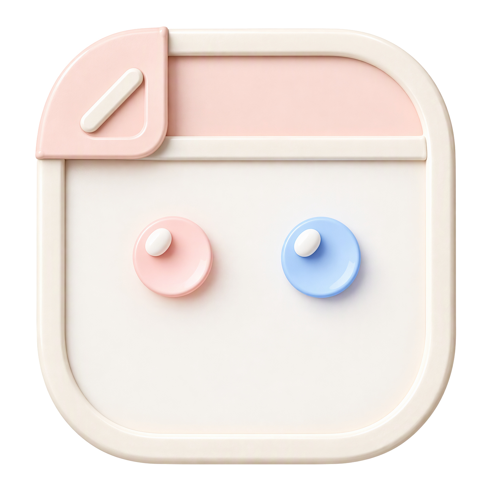

<p align="center">
  
</p>
<h1 align="center">Mico</h1>
<p align="center">A local-first canvas where people and AI agents create together.</p>
<p align="center"><a href="../README.md">简体中文</a></p>

## What it does

A local-first canvas experiment where people and local agents edit the same boards. The browser renders the canvas; the daemon owns a collection of named canvases and stores them in SQLite; the CLI and HTTP API give agents complete access to the same boards, canvases and operations. Anonymous mode keeps one `local` tenant for ordinary requests, while Entra login gives every verified identity its own private tenant. Multi-user sessions are presence rooms inside one tenant: one presenter and several participants share that tenant's boards, while members, cursors and the presenter viewport stay inside a single daemon.

Local mode trusts processes running on the machine. Cloud hosting uses the same container with a configured public origin and optional Entra login; Azure supports a disposable preview with optional managed-identity Chat and MAI transcription; MOSS is disabled in that profile. See [deployment options](deployment.md). A public deployment without login is accessible to every reachable caller. Resizing and MCP are not implemented yet. Live microphone capture needs the selected provider's credentials and proxy. Chat and MAI drawing depend on the configured AI gateway; MOSS Live uses its own voice model and native tool calls.

## Demo and multi-user sessions

Mico has no separate shared-whiteboard collection. Multi-user sessions are presence rooms **inside one tenant**: members share that tenant's canvas list, active canvas and image assets, while members, cursors, selections and the presenter viewport live in a single daemon process and do not work across replicas.

How to join:

- In demo mode (`MICO_AUTH_MODE=demo`) the browser joins the `demo` presence room automatically. `?username=<name>` sets the display name and `?sharer=true` claims the presenter slot.
- In local mode (`MICO_AUTH_MODE=none`) the **Local mode** panel switches between Local, Presenter and Guest, or open `/?localmode=presenter` and `/?localmode=guest` directly.
- The browser turns `?meetingid=<meeting id>` (equivalent to the `X-Mico-Meeting` header) into a tenant hashed from that meeting: members of one meeting share the boards and different meetings stay invisible to each other. With Entra login each verified identity still uses its own private tenant.

Room rules:

- Each room has one presenter at a time. Participants can request the presenter role from **Workspace profile**, and the presenter can invite another member or hand the role over; a request is approved automatically when the presenter does not answer within 20 seconds. When the presenter disconnects, another member of the room takes over.
- Everyone can draw and read the boards. In a presence session only the presenter can use Chat and Live voice; in demo mode only the presenter can create, rename, delete or switch canvases.
- Participants initially follow the presenter's world-space center and zoom; after panning manually the top bar offers **Follow presenter**.
- A room keeps at most 64 sessions and a daemon at most 512; a join without a connection reserves a slot for 10 seconds, a disconnected identity is retained for 60 seconds for reconnects, and a 15-second heartbeat removes dead connections.

This is **trusted presentation mode, not a secure role authorization system**: the presenter role is self-declared by the client, so anyone who can reach the service can request it.

HTTP surface (plus the existing session cookie when login is enabled):

| Interface / parameter                                              | Request / response                                                                                                                  |
| ------------------------------------------------------------------ | ----------------------------------------------------------------------------------------------------------------------------------- |
| `POST /api/whiteboards/join`                                       | `{"whiteboardid":"demo","username":"Jason Huang","sharer":true,"clientId":"<random UUID>"}` → `{token, whiteboardid, member}`       |
| `X-Mico-Whiteboard: <token>`                                       | Session token for later HTTP requests; `clientId` is a private reconnect identifier, never share it, and a name is not a credential |
| `/api/events?whiteboardsession=<token>`                            | The canvas WebSocket, which also carries presence events                                                                            |
| `/api/whiteboard-voice/mai/realtime`, `/api/whiteboard-voice/moss` | The presenter's voice connections, with the same session token                                                                      |

Besides `snapshot` and `board`, the connection receives `presence`, `cursor`, `selection` and `presenter-view` events. The client sends `{type:"cursor",point:{x,y}}` (`null` when the pointer leaves the canvas), and the presenter can also send `{type:"presenter-view",viewport:{centerX,centerY,zoom}}`; the server broadcasts per room. A room follows the active canvas of its tenant, so a canvas switch is visible to every member.

## Features

The canvas supports multiple named canvases, panning, zooming, rectangles, ellipses, typographic text, lines, freehand brush strokes, sticky notes, images, frames, HTML cards, connectors, dragging, snapping, marquee selection, color and deletion. Boards fit the viewport on first load; click Fit or press F to fit all objects again.

The bottom-left minimap and canvas-list previews share a block-only overview: notes, rectangles, ellipses, frames, HTML cards, action cards and images contribute silhouettes; standalone text, lines, connectors and strokes are ignored, including their bounds. No labels, HTML or image bytes are embedded. Click or drag the minimap to navigate, or focus it and use the arrow keys. It shows the visible viewport, accounts for the open assistant, and hides at widths of 980px or less.

The toolbar's Undo and Redo retain the last 20 successful manual edits per canvas in browser memory. A completed gesture or property submission is one step; pan/zoom and external AI/API edits are not recorded. Switching canvases retains each history; reloading clears them. A new edit clears redo. Use Cmd/Ctrl+Z to undo, Cmd/Ctrl+Shift+Z or Ctrl+Y to redo; text inputs retain native editing shortcuts. Undo restores deleted connectors, frame membership, image backgrounds and stacking order. Unrelated external edits survive; conflicting changes to affected objects block replay with a notice instead of overwriting them. History does not cover canvas creation, renaming or deletion. An unconfirmed replay pauses edits until a matching snapshot arrives; reloading discards the pending replay and local history.

The Canvases button beside the logo opens a panel listing every canvas with its name, last-updated time and a generated preview. Create, switch, rename and delete canvases there; the active canvas is shared by every connected browser, the API and the CLI, so an agent can leave work on one canvas and a person can switch to it. Deleting the final canvas is blocked. Switching canvas clears transient selection and fits the new board; reloading the page keeps the active canvas.

Drag on empty canvas with Select to marquee several objects, then Delete removes them atomically. Frame selection wraps the current selection in a named container with 32px padding. A frame is a plain container: it cannot hold another frame, it never becomes a connector endpoint for regular shapes, and its body is not clickable. Select and drag it through its top-left label; the members travel with it. Drawing a shape, line, brush stroke, sticky note or HTML card fully inside a frame automatically makes it a member, dragging an object into a frame joins it, and dragging it fully outside detaches it. Deleting a frame releases its members without deleting content. Sticky notes (N) support multiline text and seven palette choices. Text (T) supports Hand, Serif, Sans and Mono, sizes 16/18/24/32/48px and weights 300/400/500/600/700.

The image tool (I) uploads a local PNG, JPEG, WebP or GIF, up to 10 MiB, and places it on the canvas. Each canvas can contain at most five image shapes, whether uploaded or AI-generated. Image bytes are stored in the local SQLite database separately from canvas shapes and served by the daemon; canvas synchronization carries only asset IDs. Select a frame's label to choose an existing image as its background and set Cover (crop), Contain or Stretch. The image remains an independent shape; deleting it clears any frame backgrounds that reference it. Uploaded assets remain in the database even after their shapes are deleted. Canvas-list previews use an image placeholder rather than embedding the asset.

Frame titles use the purple region heading. Sticky notes support an optional editable label; AI tools can create and update it. Adding a label reserves body space and rejects collisions atomically.

The HTML card tool (W) creates an empty card and agents fill it through the batch API. Its sandboxed iframe automatically injects Bootstrap 5 CSS/JS and the shared `.mico-*` design CSS (`src/shared/htmlCardDesign.ts`) alongside inline HTML, CSS, scripts and data-URI images. The sandbox does not grant same-origin access, and its content security policy blocks external resources. Script execution is enabled for this prototype; untrusted scripts can still consume browser resources. Select the card using its top-left title to interact with its controls, or drag the title to move it. The card is a leaf: it can live inside a frame but cannot contain other objects. Only its title is editable in the interface; the markup changes through the API. The rounded shell does not clip the sandboxed iframe, so saved content remains visible at its corners.

Select the Brush tool (P) and drag to draw. The dock exposes three brush styles — pencil, marker and tapered brush — and 2/4/8px widths. The default is a 4px grape pencil stroke. Strokes persist as `path` shapes, so selecting one lets you change its brush, width and color. AI agents create the same shapes through the batch API; [`../examples/sketch.ts`](../examples/sketch.ts) draws a house, stick figure, sun and hills with 23 tapered strokes. Select the hand tool or hold Space and drag to pan. For connectors, select the connector tool and hover over or within 24 screen pixels of a source node to reveal its anchors before dragging. Drag from that node or its nearby canvas area toward a target. Frames connect only to frames; regular objects connect only to regular objects. Nearby compatible nodes reveal their anchors; the highlighted source and target anchors are the exact persisted attachments. Hover feedback clears when leaving the canvas, changing tools, panning, or pressing Escape. Select a connector to drag either endpoint to another compatible node. Dropping on empty space, cancelling a pointer, or pressing Escape leaves it unchanged. Source and Target controls in the dock properties provide a keyboard alternative. Concurrent agent edits are checked before committing a drag.

Dragging an object snaps its origin to a 16px world-space grid and aligns left/right/center or top/bottom/middle with nearby objects within six screen pixels. Matching alignments show dashed guides and take precedence over grid snapping on that axis. Objects farther than 160 screen pixels do not attract.

Canvas objects retain the candy palette in [`../src/web/design.ts`](../src/web/design.ts); the surrounding frame uses the glass and jelly tokens in [`../src/web/frame/tokens.css`](../src/web/frame/tokens.css). The canvas has an animated aurora, subtle grain and a world-aligned dot grid: its visual spacing is 24 world units at 100% zoom and adapts to stay legible while zooming. This visual grid is distinct from the 16-unit snapping grid. Reduced-motion preferences stop the aurora animation.

The identity panel holds the logo and Canvases button. A separate AI button in the top-right corner carries the breathing connection light and opens an assistant panel docked in that corner. Its icon tabs open Chat, Live, Audio and Settings. The Chat tab streams from the local Magpie gateway through the Vercel AI SDK, and every message is a canvas turn: system instructions stay byte-static for prefix KV caching, capability-gated tools match active features, anchor-preserving board context is attached only to the latest user turn, chunk-aligned compaction keeps long sessions (up to 1200 messages) compact, and the board updates live while the reply streams. Instructions support incremental work across meetings, reviews, planning sessions, and lessons rather than dumping one giant batch. An empty board offers quick starter prompts, and `?ai=<prompt>` opens the panel and sends that prompt immediately for scripted testing. The Audio tab plays prerecorded sessions. The Live tab captures microphone speech and defaults to MOSS Live, with MAI transcription available as an alternative. The unified bottom dock is fixed in screen space, and the selected object's properties open in a right-side panel; narrow viewports move that panel above the dock and wrap the dock controls instead of clipping them. Canvas pan and zoom never resize or move these panels. Controls use fixed 40px height, 20px icons and 14px text on a four-pixel spacing system: dock padding, gaps, dividers, property columns and selection insets are all multiples of four. The dock sizes to its content and keeps a four-pixel gap between buttons. Lucide icons provide every functional glyph, with hover-only shortcut hints; toolbar arrow keys move focus and Enter selects a tool. Browser page zoom is disabled with a viewport lock plus keyboard/gesture interception; canvas zoom remains separate.

### AI gateway

The server uses one [AI configuration contract](ai-configuration.md). `MICO_RUNTIME=laptop` retains the local sources below; `MICO_RUNTIME=deploy` uses only process environment configuration. `MICO_AI_AUTH_MODE=managed-identity` uses the attached Azure identity for Chat and MAI, ignores saved keys and makes Settings read-only. User login remains independent. `MICO_MOSS_ENABLED=false` disables MOSS in both the UI and server; Live then uses MAI.

Local API-key gateways use OpenAI-compatible Chat Completions; managed Azure uses the Responses API for reasoning and canvas tools. The following settings apply to local API-key mode. Open **AI → Settings** to set the endpoint, model, Live/Audio & Chat reasoning levels, and API key. Changes apply to the next request and persist in `~/.config/mico/settings.json` (owner-only permissions). The key is stored as plaintext on the local machine and is never returned to the browser. Leave the key field blank to keep the current key, or select **Remove current API key** to send requests without one. Use HTTPS for remote endpoints.

Until settings are saved, the daemon uses these environment variables and defaults:

| Variable                   | Default                    | Purpose                                                 |
| -------------------------- | -------------------------- | ------------------------------------------------------- |
| `MAGPIE_BASE_URL`          | `http://127.0.0.1:3425/v1` | Gateway URL, including `/v1`.                           |
| `MAGPIE_MODEL`             | `auto/gpt-6-sol`           | Model id sent to the gateway.                           |
| `MAGPIE_API_KEY`           | `magpie`                   | Bearer token; set it to an empty string to send none.   |
| `MAGPIE_LECTURE_REASONING` | `none`                     | Default Live/Audio & summary reasoning effort (`none`). |
| `MAGPIE_CHAT_REASONING`    | `low`                      | Default interactive Chat reasoning effort (`low`).      |

Saved settings take precedence over the environment. If the gateway is unreachable, the panel shows an actionable error and a Continue button. The assistant can only operate the canvas; it is not a general chat endpoint.

The assistant may optionally generate a relevant image with `gpt-image-2.5-flare`. Generation runs asynchronously, one image at a time; the result is placed on its original canvas without covering existing objects. Images can also be used as frame backgrounds. The daemon reads `AZURE_OPENAI_ENDPOINT` and `AZURE_OPENAI_API_KEY` from its environment; image prompts are sent to Azure and may incur charges. The underlying script accepts `{prompt, aspect}` as JSON on standard input, with aspect `1:1`, `3:2`, or `2:3`, and writes PNG bytes to standard output.

### Live session mode

The Live tab defaults to MOSS Live full-duplex voice. Select **MAI Transcribe** to use the original microphone transcription and AI drawing pipeline instead. Microphone permission is requested only when recording starts; stopping, switching providers, leaving Live, or closing the panel releases the microphone.

MOSS receives microphone audio and the active canvas context, speaks responses, and calls the existing canvas tools directly while audio continues. A tool result is returned to MOSS only after execution; canvas revision conflicts require a fresh board read. The MOSS session uses the server-only `MOSS_API_KEY` from `.env` and is billed while connected. The Audio tab plays recorded sessions through Azure `MAI-Transcribe-2-Streaming`; MAI Live similarly sends confirmed transcript segments to the configured AI gateway.

- [`../src/web/stt/`](../src/web/stt/) contains the PCM resampler, WebSocket client and energy-based silence segmenter. Audio playback defaults to `500 ms` silence cut and accepts up to `1000 ms` in the slider; MAI live microphone mode defaults to `900 ms` with a 15-second hard cap and coalesces standalone filler turns into the next substantive utterance.
- [`../src/server/mossProxy.ts`](../src/server/mossProxy.ts) proxies `/moss` to MOSS with server-side authorization; [`../src/server/mossApi.ts`](../src/server/mossApi.ts) exposes validated, canvas-pinned native tools through the local daemon. The key is never sent to the browser.
- [`../src/server/maiProxy.ts`](../src/server/maiProxy.ts) is a Vite WebSocket proxy that attaches the Azure `api-key` header. It serves `/mai/config` and proxies `/mai/realtime`.
- `.env` supplies `MOSS_API_KEY` for MOSS and `AZURE_MAI_HOST`, `AZURE_OPENAI_API_KEY` and `AZURE_OPENAI_DEPLOYMENT` for MAI. Copy [`../.env.example`](../.env.example) to `.env` and fill the values; `.env` is ignored by Git.
- [`../public/evals/`](../public/evals/) contains generated session MP3s and `manifest.json`: ten school lessons, ten meeting/planning cases, and a Microsoft earnings outlook briefing. Additional multi-topic transcripts (`c14-quarterly-product-review.zh.txt`, `c15-architecture-tradeoffs.en.txt`) and [`../evals/cases/layered-eval-suite.json`](../evals/cases/layered-eval-suite.json) cover multi-topic meetings.
- The Live panel includes the waveform with commit markers, live confirmed/hypothesis text, a VAD energy meter, playback speed, silence threshold, per-segment latency, a `New canvas` button and a `Create session summary` action. Sessions are organized into vertically stacked horizontal **Topic Swimlanes** (`evidence → synthesis → topic-card-<slug>`). Topic transitions immediately emit or update `topic-card-<slug>` for the completed topic; revisits update the existing lane and card in place; post-session wrap-up backfills any open topic card, creates/updates a conditional `executive-summary` when `>= 2` topics were discussed, and maintains one global checklist via `upsert_action_card`. AI-generated HTML can embed supported Lucide placeholders and `.mico-*` classes without changing the sandbox policy.
- The AI groups existing related objects in frames, expands their bounds when members grow, and rejects frame growth that would overlap unrelated content. Manual frame editing keeps its existing behavior. Live content can extend across the canvas instead of being confined to the initial viewport.
- `New canvas` creates and activates a named canvas so any meeting, review, or lesson starts from an empty board. The AI serializes both turn requests and same-step tool executions (eliminating concurrent revision conflicts), adapts batch size under queue backlog (`3 → 6 → 8` segments, flushing on session end), and recovers post-session summaries after transient mid-session errors. Incomplete or non-visual segments can return `WAIT`, which renders as a small waiting chip without drawing.
- `?ai=<prompt>` still opens the chat and submits immediately for scripted tests.

## Usage

### Requirements

- Node.js 24 or newer
- pnpm

### Run

```sh
pnpm install
pnpm daemon
```

In another terminal:

```sh
pnpm dev
```

Open <https://mico.dev.hexly.ai/>. Caddy proxies to Vite on `127.0.0.1:7063`; Vite proxies `/api` (including WebSocket upgrades) to the loopback-only daemon on `127.0.0.1:37063`. The browser uses same-origin HTTPS/WSS, never mixed-content loopback requests. The daemon stores all canvases in `.mico/board.sqlite`; a database created by an older single-board version is migrated to a canvas named “My canvas” on first start.

### Local Docker deployment

```sh
docker compose up --build -d --wait
```

Open <http://127.0.0.1:47063/>. One non-root container serves the production UI, API, canvas WebSocket and both voice proxies. Named volumes retain canvases, images and AI settings across container recreation without touching the host's daily board. Provider credentials are optional for ordinary drawing. The port is published on loopback only; Mico is not an authenticated public server.

See [the Docker guide](docker.md) for provider configuration, persistence, shutdown and the isolated Chrome acceptance check.

### Cloud preview

Hosting, login and AI availability are independent settings. The [deployment guide](deployment.md) compares Azure Container Apps, other container/VM hosts and Cloudflare paths. The first automated target is an [Azure preview](deployment-azure.md): optional Microsoft SPA login, optional managed-identity Chat/MAI, manual drawing, one replica and temporary SQLite. **Container replacement or redeployment may erase every canvas and image.** Supply tenant, subscription, resource group, App ID and user IDs through operator environment configuration, never committed source.

For subsequent hosted updates, use the project [mico-deploy skill](../.agents/skills/mico-deploy/SKILL.md) (`/skill:mico-deploy` in agents that expose skill commands). It keeps private deployment configuration outside Git and verifies the exact deployed image.

### Agent CLI

Commands write JSON to standard output; errors go to standard error and return a nonzero exit code. The CLI talks directly to the local daemon without a model provider or cloud service.

```sh
node src/cli/index.ts canvas list
node src/cli/index.ts canvas list --preview
node src/cli/index.ts canvas create --name "Research" --use
node src/cli/index.ts canvas use <id>
node src/cli/index.ts canvas rename <id> "New name"
node src/cli/index.ts canvas delete <id>
node src/cli/index.ts canvas get <id>
node src/cli/index.ts board get
node src/cli/index.ts board get --canvas <id>
node src/cli/index.ts shape create '{"type":"rectangle","x":100,"y":100,"w":180,"h":80,"color":"#5b5fc7","text":"Hello"}' --canvas <id>
node src/cli/index.ts shape update <id> '{"x":300,"y":200}'
node src/cli/index.ts shape delete <id>
node src/cli/index.ts batch examples/architecture.json --canvas <id>
node examples/distributed-architecture.ts | node src/cli/index.ts batch -
node examples/sketch.ts | node src/cli/index.ts batch -
```

Canvas and shape commands default to the active canvas. `--canvas <id>` targets another canvas without switching away from the current one; the response still contains that canvas's board. `canvas list` omits the large preview data URLs unless `--preview` is passed.

The distributed-commerce example adds 20 services and clients, 27 connectors, and six headings to the right of the original Mico diagram without deleting existing objects. Its fixed `commerce-` IDs make duplicate application fail atomically. Click Fit after adding it to an open board.

`shape create` generates an ID if one is omitted. A batch is an array of `create`, `update`, or `delete` operations; use `-` instead of a filename to read JSON from standard input. Batch-created shapes must include IDs so that connectors can refer to them. The example uses fixed IDs and can be applied once to an empty board. Deleting a shape also deletes connectors attached to it; connector endpoints must be different.

For images, upload the file first, then use the returned asset ID to create a shape. Frame backgrounds reference the shape ID, not the asset ID:

```sh
curl -X POST -H 'Content-Type: image/png' --data-binary @photo.png http://127.0.0.1:37063/api/images
node src/cli/index.ts shape create '{"id":"photo","type":"image","imageId":"<uploaded-id>","x":100,"y":100,"w":320,"h":240,"color":"#1a1a1a"}'
node src/cli/index.ts shape update <frame-id> '{"backgroundImageId":"photo","backgroundFit":"cover"}'
```

A canvas shape has `id`, `type` (`rectangle`, `ellipse`, `text`, `line`, `note`, `path`, `frame`, `html`, `actions`, or `image`), `x`, `y`, `w`, `h`, `color` (six-digit hex), and optional `text`. For a line, `w` and `h` are signed offsets to its endpoint. An `image` references a previously uploaded asset through `imageId` and can be a frame member. A `frame` has a required non-empty `title` of at most 120 characters and no `frameId`; it cannot nest. Its optional `backgroundImageId` references an image shape on the same canvas, and `backgroundFit` is `cover` (default), `contain`, or `stretch`. Set `backgroundImageId` to `null` in an update to clear the background. An `html` card has a required `title` and `html` (up to 200 000 characters) and may carry `frameId` to sit inside a frame. An `actions` card has a `title` and `items` containing stable `id`, `text`, and boolean `done` values; it may carry `frameId`. `set_action_done` updates one item and requires `expectedRevision`. Regular shapes and cards may carry `frameId` naming an existing frame; only frames can be referenced. A connector has `id`, `type: "connector"`, `from` and `to` shape IDs, and `color`; both endpoints must be frames or both must be non-frames. A `path` shape has `points` (2–4096 points relative to its `x`/`y`, inside its `w`/`h` bounds), `brush` (`pencil`, `marker`, `brush`) and `strokeWidth` (1–64). Paths use the same anchors, dragging and snapping as other shapes. Validation rejects out-of-bounds points or unknown brushes atomically with the rest of the batch. Optional `fromAnchor` and `toAnchor` pin either endpoint to an exact anchor index: boxes/text/notes/HTML cards/frames have 12 anchors, lines have five. Pins must be non-negative integers inside the referenced node's anchor range; invalid pins reject the entire batch. Unpinned endpoints use automatic nearest-outward routing. Pinned attachments follow their nodes as they move.

### Daemon API

- `GET /api/live` — status and the manifest-derived version.
- `GET /api/state` — `{stateVersion, activeCanvasId, canvases, board}` for the active canvas; ideal for agents and initial loads. Add `?previews=0` to omit previews from the summaries while polling.
- `GET /api/canvases` — `{stateVersion, activeCanvasId, canvases}`. Each summary has `id`, `name`, `revision`, `createdAt`, `updatedAt` and a bounded 160×100 SVG data-URL `preview`; add `?previews=0` to omit previews.
- `POST /api/canvases` — `{name?, activate?}`; returns the updated state plus `createdCanvasId`.
- `GET /api/canvases/:id` — `{canvas, board}` for one canvas.
- `PATCH /api/canvases/:id` — `{name}`; returns the updated state.
- `DELETE /api/canvases/:id` — removes the canvas and returns the updated state. Deleting the last canvas is rejected with `LAST_CANVAS`.
- `PUT /api/active-canvas` — `{id}`; switches the shared active canvas and returns the updated state.
- `GET /api/board` — the active canvas's `{revision, shapes}`.
- `POST /api/images` — upload raw PNG, JPEG, WebP or GIF bytes with the matching `Content-Type`, up to 10 MiB; returns `{id}`. `GET /api/images/:id` serves the stored bytes. Remote image URLs are not fetched.
- `POST /api/operations` — `{operations, expectedRevision?, canvasId?}`; defaults to the active canvas and can target any canvas without switching. Returns that canvas's board.
- `GET /api/ai/settings` / `PUT /api/ai/settings` — read or update `{baseURL, model, apiKey?}`. Reads return `{baseURL, model, hasApiKey, readOnly}` without the key; omit `apiKey` on local updates to keep it, or send an empty string to remove it. Deploy mode rejects updates with `403 AI_SETTINGS_READ_ONLY`.
- `GET /api/ai/models` — `{models: string[]}`. Fetches the OpenAI-compatible `/models` endpoint from the currently saved effective `baseURL` with the server-side API key; the key is never returned or sent to the browser. The configured baseURL prefix is preserved, for example `/v1/models`.
- `POST /api/ai/chat` — `{messages, selection}`; streams Vercel AI SDK UI message chunks. Server-side tools read and mutate the active canvas and broadcast the same `board` events as `POST /api/operations`. `selection` is an array of shape ids that the user marqueed; the assistant receives their geometry and labels as primary context.
- `GET /api/events` — WebSocket events. On connect and after canvas create/rename/delete/switch the daemon sends `{type: "snapshot", stateVersion, activeCanvasId, canvases, board}`; after operations it sends `{type: "board", canvasId, canvas, board}`. `stateVersion` increases on canvas metadata changes so clients can ignore delayed snapshots; clients update preview metadata from `canvas` and only apply `board` when `canvasId` is their active canvas.

History replay also uses `{type: "restore", shape, index}` operations: restore an exact shape at its zero-based stacking position, replacing the same ID without delete cascades. These operations require `expectedRevision` and validate the final board and image limits atomically. Restore/delete-only replay batches allow up to 64 MiB so rich-card restoration can exceed the ordinary 1 MiB request cap. No history is stored by the daemon.

A batch is validated and persisted atomically per canvas. An optional `expectedRevision` rejects writes based on stale canvas state. A canvas name is trimmed, 1–80 characters, and rejected if it contains control characters.

## Development

Vite hot-reloads frontend changes; `pnpm daemon` watches daemon source changes and restarts automatically. API and CLI writes update open canvases live over WebSocket, with automatic reconnection and a three-second polling fallback. `MICO_PORT` overrides the daemon port for the daemon, CLI, and Vite proxy; set it consistently in both terminals. `MICO_DB_PATH` overrides the database path.

Port allocation: development `7063`, E2E `17063`, browser/BDD `27063`, internal daemon `37063`. Automated tests must use an isolated database and loopback endpoint, not the daily board. The shared Caddy mapping lives in `workflow/caddy/Caddyfile` and the active machine's `/opt/homebrew/etc/Caddyfile`; the existing `*.dev.hexly.ai` certificate covers this hostname.

After a recorded or MAI session ends, the summary request asks AI to backfill any unclosed `topic-card-<slug>`, create/update `executive-summary` when `>= 2` topics exist, and update one global action card via `upsert_action_card`. Action items have stable IDs and persisted completion state; checkbox changes support undo. Empty sessions produce an empty card rather than invented tasks. [`../src/web/htmlCard.ts`](../src/web/htmlCard.ts) injects the `.mico-*` design CSS from `src/shared/htmlCardDesign.ts` at render time so generated card markup stays small. MOSS Live has the same tools and multi-topic swimlane instructions, but stopping MOSS does not automatically request a post-session summary.

The layered AI pipeline evaluator [`../scripts/ai-pipeline-eval.ts`](../scripts/ai-pipeline-eval.ts) (`pnpm eval:ai --json`) measures offline L1–L5 metrics (tool schema size, parallel serialization, KV-cache stability, 180-shape anchor retention, 120-turn compaction, VAD/queue lag and recovery, multi-topic prompt checks). The replay harness [`../scripts/run-ai-cases.ts`](../scripts/run-ai-cases.ts) feeds case transcripts sentence by sentence to the daemon and requests the post-session summary. Round artifacts, board snapshots and screenshots live under [`../evals/runs/`](../evals/runs/). Explicitly authorized live-provider evaluations support single-topic and multi-topic fixtures, virtual-clock audio catch-up benchmarking (`scripts/audio-latency-bench.ts`), and real-browser MAI playback (`scripts/verify-real-audio.ts`); see [`ai-performance-tuning.md`](ai-performance-tuning.md).

Development uses the Vite adapters for MOSS and MAI. The [Docker runtime](docker.md) serves the built frontend and reuses the same server-side proxies without Vite.

## Tests

```sh
pnpm check              # Biome with zero warnings + TypeScript
pnpm test              # every Node test file, discovered under src/ and scripts/
pnpm test:unit          # L1: pure logic, store, STT and component logic
pnpm test:integration   # L3: real daemon over HTTP/WebSocket, CLI, agent examples
pnpm eval:ai            # Offline L1-L5 AI pipeline metrics & threshold check
pnpm test:e2e           # L4: the browser subset gated in CI
pnpm test:browser       # L4: every Playwright spec
pnpm build
pnpm hooks:install     # once per clone: point core.hooksPath at .githooks
```

Pushes and pull requests run [`../.github/workflows/ci.yml`](../.github/workflows/ci.yml), which calls base-ci's `quality.yml` (pinned to a full commit SHA) per System0 slot; branch protection only needs `quality / Z1: Gate`.

Testing layers, isolation rules, the agent API contract and the coverage map live in [`testing.md`](testing.md).

Browser checks require installed Google Chrome and run sequentially on `127.0.0.1:27063`, with an isolated daemon on `57063`, a temporary SQLite database, and a separate Vite cache. The suite refuses to seed another origin and never changes the daily `.mico` board. It covers canvas creation, switching, renaming, deletion, previews and AI-targeted canvas operations; tool buttons and shortcuts, every drawing primitive, dock options, panel edits, inline text editing, frame label selection and member travel, automatic frame membership on draw and drag, frame-only connectors, HTML card rendering and title editing, drag snapping with alignment guides, connector creation/rebinding/cancellation, keyboard alternatives, concurrent API edits, grid/world alignment and unchanged frame geometry from 5% to 300% zoom. Responsive checks keep every dock control and its color panel visible at narrow and wide widths.

## Stack

| Technology    | Role                                                |
| ------------- | --------------------------------------------------- |
| React 19      | Browser canvas interface                            |
| Vite 8        | Development server and build                        |
| TypeScript    | Source and shared contracts                         |
| Node.js 24    | Daemon, HTTP API, CLI and WebSocket synchronization |
| SQLite        | Local named-canvas and asset storage                |
| Vercel AI SDK | OpenAI-compatible streaming and canvas tools        |
| Bootstrap 5   | HTML card rendering inside the sandboxed iframe     |
| Lucide        | Interface icons                                     |
| Biome         | Formatting and static checks                        |
| Playwright    | Browser interaction tests                           |

## Documentation

- [`docker.md`](docker.md) — Local Docker deployment, persistence and acceptance checks.
- [`ai-performance-tuning.md`](ai-performance-tuning.md) — AI latency tuning, KV-cache compaction and reproducible 3-tier Audio benchmarks.
- [`testing.md`](testing.md) — testing layers, isolation and the agent API contract.
- [`prototypes/`](prototypes/) — standalone interface prototypes.
- [`../examples/`](../examples/) — agent batch examples and TypeScript generators.
- [`../evals/`](../evals/) — recorded session cases and evaluation runs.
- [`../.env.example`](../.env.example) — placeholder names for local credentials.
- [`../CHANGELOG.md`](../CHANGELOG.md) — release history.
- [`../Retrospective.md`](../Retrospective.md) — incident notes.
- [`../artwork/`](../artwork/) — identity artwork records.

## License

MIT; see [`../LICENSE`](../LICENSE). Copyright (c) 2026 Zheng Li.
