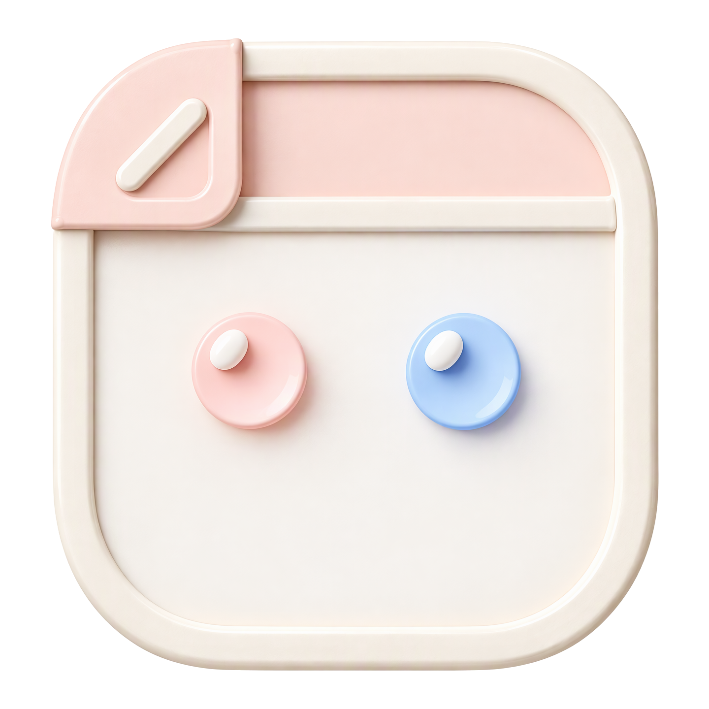

<p align="center">
  
</p>
<h1 align="center">Mico</h1>
<p align="center">A local-first canvas where people and AI agents create together.</p>
<p align="center"><a href="../README.md">简体中文</a></p>

## What it does

A local-first canvas experiment where people and local agents edit the same boards. The browser renders the canvas; the daemon owns a collection of named canvases and stores them in SQLite; the CLI and HTTP API give agents complete access to the same boards, canvases and operations.

This is a single local canvas collection, not a multi-user server. It has no authentication beyond restricting browser origins and hosts, and trusts processes running on the local machine. Do not expose the daemon to a network. Undo/redo, resizing, remote deployment, and MCP are not implemented yet. Live microphone capture needs the selected provider's credentials and proxy. Chat and MAI drawing depend on the configured AI gateway; MOSS Live uses its own voice model and native tool calls.

## Features

The canvas supports multiple named canvases, panning, zooming, rectangles, ellipses, typographic text, lines, freehand brush strokes, sticky notes, images, frames, HTML cards, connectors, dragging, snapping, marquee selection, color and deletion. Boards fit the viewport on first load; click Fit or press F to fit all objects again.

The Canvases button beside the logo opens a panel listing every canvas with its name, last-updated time and a generated preview. Create, switch, rename and delete canvases there; the active canvas is shared by every connected browser, the API and the CLI, so an agent can leave work on one canvas and a person can switch to it. Deleting the final canvas is blocked. Switching canvas clears transient selection and fits the new board; reloading the page keeps the active canvas.

Drag on empty canvas with Select to marquee several objects, then Delete removes them atomically. Frame selection wraps the current selection in a named container with 32px padding. A frame is a plain container: it cannot hold another frame, it never becomes a connector endpoint for regular shapes, and its body is not clickable. Select and drag it through its top-left label; the members travel with it. Drawing a shape, line, brush stroke, sticky note or HTML card fully inside a frame automatically makes it a member, dragging an object into a frame joins it, and dragging it fully outside detaches it. Deleting a frame releases its members without deleting content. Sticky notes (N) support multiline text and seven palette choices. Text (T) supports Hand, Serif, Sans and Mono, sizes 16/18/24/32/48px and weights 300/400/500/600/700.

The image tool (I) uploads a local PNG, JPEG, WebP or GIF, up to 10 MiB, and places it on the canvas. Each canvas can contain at most five image shapes, whether uploaded or AI-generated. Image bytes are stored in the local SQLite database separately from canvas shapes and served by the daemon; canvas synchronization carries only asset IDs. Select a frame's label to choose an existing image as its background and set Cover (crop), Contain or Stretch. The image remains an independent shape; deleting it clears any frame backgrounds that reference it. Uploaded assets remain in the database even after their shapes are deleted. Canvas-list previews use an image placeholder rather than embedding the asset.

The HTML card tool (W) creates an empty card and agents fill it through the batch API. Its sandboxed iframe embeds Bootstrap 5 CSS and JavaScript inline, and renders inline HTML, CSS, scripts and data-URI images. The sandbox does not grant same-origin access, and its content security policy blocks external resources. Script execution is enabled for this prototype; untrusted scripts can still consume browser resources. Select the card using its top-left title to interact with its controls, or drag the title to move it. The card is a leaf: it can live inside a frame but cannot contain other objects. Only its title is editable in the interface; the markup changes through the API. The rounded shell does not clip the sandboxed iframe, so saved content remains visible at its corners.

Select the Brush tool (P) and drag to draw. The dock exposes three brush styles — pencil, marker and tapered brush — and 2/4/8px widths. The default is a 4px grape pencil stroke. Strokes persist as `path` shapes, so selecting one lets you change its brush, width and color. AI agents create the same shapes through the batch API; [`../examples/sketch.ts`](../examples/sketch.ts) draws a house, stick figure, sun and hills with 23 tapered strokes. Select the hand tool or hold Space and drag to pan. For connectors, select the connector tool and drag from a source node toward a target. Frames connect only to frames; regular objects connect only to regular objects. Nearby compatible nodes reveal their anchors; the highlighted anchor is the exact persisted attachment. Select a connector to drag either endpoint to another compatible node. Dropping on empty space, cancelling a pointer, or pressing Escape leaves it unchanged. Source and Target controls in the dock properties provide a keyboard alternative. Concurrent agent edits are checked before committing a drag.

Dragging an object snaps its origin to a 16px world-space grid and aligns left/right/center or top/bottom/middle with nearby objects within six screen pixels. Matching alignments show dashed guides and take precedence over grid snapping on that axis. Objects farther than 160 screen pixels do not attract.

Canvas objects retain the candy palette in [`../src/web/design.ts`](../src/web/design.ts); the surrounding frame uses the glass and jelly tokens in [`../src/web/frame/tokens.css`](../src/web/frame/tokens.css). The canvas has an animated aurora, subtle grain and a world-aligned dot grid: its visual spacing is 24 world units at 100% zoom and adapts to stay legible while zooming. This visual grid is distinct from the 16-unit snapping grid. Reduced-motion preferences stop the aurora animation.

The identity panel holds the logo and Canvases button. A separate AI button in the top-right corner carries the breathing connection light and opens an assistant panel docked in that corner. Its icon tabs open Chat, Live, Audio and Settings. The Chat tab streams from the local Magpie gateway through the Vercel AI SDK, and every message is a canvas turn: the assistant reads the board and the current marquee selection, calls drawing tools, and the board updates live while the reply streams. Instructions require incremental work — start with a title and the core objects, inspect the board, then adjust and extend instead of dumping one batch — so a science lesson appears step by step. An empty board offers quick lesson prompts, and `?ai=<prompt>` opens the panel and sends that prompt immediately for scripted testing. The Audio tab plays prerecorded sessions. The Live tab captures microphone speech and defaults to MOSS Live, with MAI transcription available as an alternative. The unified bottom dock is fixed in screen space, and the selected object's properties open in a right-side panel; narrow viewports move that panel above the dock and wrap the dock controls instead of clipping them. Canvas pan and zoom never resize or move these panels. Controls use fixed 40px height, 20px icons and 14px text on a four-pixel spacing system: dock padding, gaps, dividers, property columns and selection insets are all multiples of four. The dock sizes to its content and keeps a four-pixel gap between buttons. Lucide icons provide every functional glyph, with hover-only shortcut hints; toolbar arrow keys move focus and Enter selects a tool. Browser page zoom is disabled with a viewport lock plus keyboard/gesture interception; canvas zoom remains separate.

### AI gateway

The assistant uses the OpenAI-compatible Chat Completions API. Open **AI → Settings** to set the endpoint, model and API key. Changes apply to the next request and persist in `~/.config/mico/settings.json` (owner-only permissions). The key is stored as plaintext on the local machine and is never returned to the browser. Leave the key field blank to keep the current key, or select **Remove current API key** to send requests without one. Use HTTPS for remote endpoints.

Until settings are saved, the daemon uses these environment variables and defaults:

| Variable          | Default                    | Purpose                                               |
| ----------------- | -------------------------- | ----------------------------------------------------- |
| `MAGPIE_BASE_URL` | `http://127.0.0.1:3425/v1` | Gateway URL, including `/v1`.                         |
| `MAGPIE_MODEL`    | `auto/gpt-6-luna`          | Model id sent to the gateway.                         |
| `MAGPIE_API_KEY`  | `magpie`                   | Bearer token; set it to an empty string to send none. |

Saved settings take precedence over the environment. If the gateway is unreachable, the panel shows an actionable error and a Continue button. The assistant can only operate the canvas; it is not a general chat endpoint.

The assistant may optionally generate a relevant image with `gpt-image-2.5-flare`. Generation runs asynchronously, one image at a time; the result is placed on its original canvas without covering existing objects. Images can also be used as frame backgrounds. The daemon reads `AZURE_OPENAI_ENDPOINT` and `AZURE_OPENAI_API_KEY` from its environment; image prompts are sent to Azure and may incur charges. The underlying script accepts `{prompt, aspect}` as JSON on standard input, with aspect `1:1`, `3:2`, or `2:3`, and writes PNG bytes to standard output.

### Live session mode

The Live tab defaults to MOSS Live full-duplex voice. Select **MAI Transcribe** to use the original microphone transcription and AI drawing pipeline instead. Microphone permission is requested only when recording starts; stopping, switching providers, leaving Live, or closing the panel releases the microphone.

MOSS receives microphone audio and the active canvas context, speaks responses, and calls the existing canvas tools directly while audio continues. A tool result is returned to MOSS only after execution; canvas revision conflicts require a fresh board read. The MOSS session uses the server-only `MOSS_API_KEY` from `.env` and is billed while connected. The Audio tab plays recorded sessions through Azure `MAI-Transcribe-2-Streaming`; MAI Live similarly sends confirmed transcript segments to the configured AI gateway.

- [`../src/web/stt/`](../src/web/stt/) contains the PCM resampler, WebSocket client and energy-based silence segmenter. Audio mode defaults to one second of silence and waits for a pause rather than cutting continuous speech at 15 seconds; the silence threshold is adjustable in the panel. MAI microphone mode retains its 500 ms default and 15-second cap.
- [`../src/server/mossProxy.ts`](../src/server/mossProxy.ts) proxies `/moss` to MOSS with server-side authorization; [`../src/server/mossApi.ts`](../src/server/mossApi.ts) exposes validated, canvas-pinned native tools through the local daemon. The key is never sent to the browser.
- [`../src/server/maiProxy.ts`](../src/server/maiProxy.ts) is a Vite WebSocket proxy that attaches the Azure `api-key` header. It serves `/mai/config` and proxies `/mai/realtime`.
- `.env` supplies `MOSS_API_KEY` for MOSS and `AZURE_MAI_HOST`, `AZURE_OPENAI_API_KEY` and `AZURE_OPENAI_DEPLOYMENT` for MAI. Copy [`../.env.example`](../.env.example) to `.env` and fill the values; `.env` is ignored by Git.
- [`../public/evals/`](../public/evals/) contains generated session MP3s and `manifest.json`: ten school lessons, ten meeting/planning cases, and a Microsoft earnings outlook briefing. Scripts, catalog, and the briefing's sources are in [`../evals/cases/`](../evals/cases/).
- The Live panel includes the waveform with commit markers, live confirmed/hypothesis text, a VAD energy meter, playback speed, silence threshold, per-segment latency, a `New canvas` button and a `Create session summary` action. When the speaker reaches a wrap-up, the AI can create a visual HTML summary; after the session ends and the queue drains, it is asked to create or update the same card. AI-generated HTML can embed supported Lucide icons as inline SVG without changing the sandbox policy.
- The AI groups existing related objects in frames, expands their bounds when members grow, and rejects frame growth that would overlap unrelated content. Manual frame editing keeps its existing behavior. Live content can extend across the canvas instead of being confined to the initial viewport.
- `New canvas` creates and activates a named canvas so a lecture starts from an empty board. The AI keeps its queue serialized: one lecture request at a time, with up to three pending segments coalesced when it falls behind. Segments that are incomplete or carry no new visual fact can return exactly `WAIT`; those replies render as a small waiting chip and do not draw.
- `?ai=<prompt>` still opens the chat and submits immediately for scripted tests.

## Usage

### Requirements

- Node.js 24 or newer
- pnpm

### Run

```sh
pnpm install
pnpm daemon
```

In another terminal:

```sh
pnpm dev
```

Open <https://mico.dev.hexly.ai/>. Caddy proxies to Vite on `127.0.0.1:7063`; Vite proxies `/api` (including WebSocket upgrades) to the loopback-only daemon on `127.0.0.1:37063`. The browser uses same-origin HTTPS/WSS, never mixed-content loopback requests. The daemon stores all canvases in `.mico/board.sqlite`; a database created by an older single-board version is migrated to a canvas named “My canvas” on first start.

### Agent CLI

Commands write JSON to standard output; errors go to standard error and return a nonzero exit code. The CLI talks directly to the local daemon without a model provider or cloud service.

```sh
node src/cli/index.ts canvas list
node src/cli/index.ts canvas list --preview
node src/cli/index.ts canvas create --name "Research" --use
node src/cli/index.ts canvas use <id>
node src/cli/index.ts canvas rename <id> "New name"
node src/cli/index.ts canvas delete <id>
node src/cli/index.ts canvas get <id>
node src/cli/index.ts board get
node src/cli/index.ts board get --canvas <id>
node src/cli/index.ts shape create '{"type":"rectangle","x":100,"y":100,"w":180,"h":80,"color":"#5b5fc7","text":"Hello"}' --canvas <id>
node src/cli/index.ts shape update <id> '{"x":300,"y":200}'
node src/cli/index.ts shape delete <id>
node src/cli/index.ts batch examples/architecture.json --canvas <id>
node examples/distributed-architecture.ts | node src/cli/index.ts batch -
node examples/sketch.ts | node src/cli/index.ts batch -
```

Canvas and shape commands default to the active canvas. `--canvas <id>` targets another canvas without switching away from the current one; the response still contains that canvas's board. `canvas list` omits the large preview data URLs unless `--preview` is passed.

The distributed-commerce example adds 20 services and clients, 27 connectors, and six headings to the right of the original Mico diagram without deleting existing objects. Its fixed `commerce-` IDs make duplicate application fail atomically. Click Fit after adding it to an open board.

`shape create` generates an ID if one is omitted. A batch is an array of `create`, `update`, or `delete` operations; use `-` instead of a filename to read JSON from standard input. Batch-created shapes must include IDs so that connectors can refer to them. The example uses fixed IDs and can be applied once to an empty board. Deleting a shape also deletes connectors attached to it; connector endpoints must be different.

For images, upload the file first, then use the returned asset ID to create a shape. Frame backgrounds reference the shape ID, not the asset ID:

```sh
curl -X POST -H 'Content-Type: image/png' --data-binary @photo.png http://127.0.0.1:37063/api/images
node src/cli/index.ts shape create '{"id":"photo","type":"image","imageId":"<uploaded-id>","x":100,"y":100,"w":320,"h":240,"color":"#1a1a1a"}'
node src/cli/index.ts shape update <frame-id> '{"backgroundImageId":"photo","backgroundFit":"cover"}'
```

A canvas shape has `id`, `type` (`rectangle`, `ellipse`, `text`, `line`, `note`, `path`, `frame`, `html`, or `image`), `x`, `y`, `w`, `h`, `color` (six-digit hex), and optional `text`. For a line, `w` and `h` are signed offsets to its endpoint. An `image` references a previously uploaded asset through `imageId` and can be a frame member. A `frame` has a required non-empty `title` of at most 120 characters and no `frameId`; it cannot nest. Its optional `backgroundImageId` references an image shape on the same canvas, and `backgroundFit` is `cover` (default), `contain`, or `stretch`. Set `backgroundImageId` to `null` in an update to clear the background. An `html` card has a required `title` and `html` (up to 200 000 characters) and may carry `frameId` to sit inside a frame. Regular shapes and cards may carry `frameId` naming an existing frame; only frames can be referenced. A connector has `id`, `type: "connector"`, `from` and `to` shape IDs, and `color`; both endpoints must be frames or both must be non-frames. A `path` shape has `points` (2–4096 points relative to its `x`/`y`, inside its `w`/`h` bounds), `brush` (`pencil`, `marker`, `brush`) and `strokeWidth` (1–64). Paths use the same anchors, dragging and snapping as other shapes. Validation rejects out-of-bounds points or unknown brushes atomically with the rest of the batch. Optional `fromAnchor` and `toAnchor` pin either endpoint to an exact anchor index: boxes/text/notes/HTML cards/frames have 12 anchors, lines have five. Pins must be non-negative integers inside the referenced node's anchor range; invalid pins reject the entire batch. Unpinned endpoints use automatic nearest-outward routing. Pinned attachments follow their nodes as they move.

### Daemon API

- `GET /api/live` — status and the manifest-derived version.
- `GET /api/state` — `{stateVersion, activeCanvasId, canvases, board}` for the active canvas; ideal for agents and initial loads. Add `?previews=0` to omit previews from the summaries while polling.
- `GET /api/canvases` — `{stateVersion, activeCanvasId, canvases}`. Each summary has `id`, `name`, `revision`, `createdAt`, `updatedAt` and a bounded 160×100 SVG data-URL `preview`; add `?previews=0` to omit previews.
- `POST /api/canvases` — `{name?, activate?}`; returns the updated state plus `createdCanvasId`.
- `GET /api/canvases/:id` — `{canvas, board}` for one canvas.
- `PATCH /api/canvases/:id` — `{name}`; returns the updated state.
- `DELETE /api/canvases/:id` — removes the canvas and returns the updated state. Deleting the last canvas is rejected with `LAST_CANVAS`.
- `PUT /api/active-canvas` — `{id}`; switches the shared active canvas and returns the updated state.
- `GET /api/board` — the active canvas's `{revision, shapes}`.
- `POST /api/images` — upload raw PNG, JPEG, WebP or GIF bytes with the matching `Content-Type`, up to 10 MiB; returns `{id}`. `GET /api/images/:id` serves the stored bytes. Remote image URLs are not fetched.
- `POST /api/operations` — `{operations, expectedRevision?, canvasId?}`; defaults to the active canvas and can target any canvas without switching. Returns that canvas's board.
- `GET /api/ai/settings` / `PUT /api/ai/settings` — read or update `{baseURL, model, apiKey?}`. Reads return `{baseURL, model, hasApiKey}` without the key; omit `apiKey` on update to keep it, or send an empty string to remove it.
- `GET /api/ai/models` — `{models: string[]}`. Fetches the OpenAI-compatible `/models` endpoint from the currently saved effective `baseURL` with the server-side API key; the key is never returned or sent to the browser. The configured baseURL prefix is preserved, for example `/v1/models`.
- `POST /api/ai/chat` — `{messages, selection}`; streams Vercel AI SDK UI message chunks. Server-side tools read and mutate the active canvas and broadcast the same `board` events as `POST /api/operations`. `selection` is an array of shape ids that the user marqueed; the assistant receives their geometry and labels as primary context.
- `GET /api/events` — WebSocket events. On connect and after canvas create/rename/delete/switch the daemon sends `{type: "snapshot", stateVersion, activeCanvasId, canvases, board}`; after operations it sends `{type: "board", canvasId, canvas, board}`. `stateVersion` increases on canvas metadata changes so clients can ignore delayed snapshots; clients update preview metadata from `canvas` and only apply `board` when `canvasId` is their active canvas.

A batch is validated and persisted atomically per canvas. An optional `expectedRevision` rejects writes based on stale canvas state. A canvas name is trimmed, 1–80 characters, and rejected if it contains control characters.

## Development

Vite hot-reloads frontend changes; `pnpm daemon` watches daemon source changes and restarts automatically. API and CLI writes update open canvases live over WebSocket, with automatic reconnection and a three-second polling fallback. `MICO_PORT` overrides the daemon port for the daemon, CLI, and Vite proxy; set it consistently in both terminals. `MICO_DB_PATH` overrides the database path.

Port allocation: development `7063`, E2E `17063`, browser/BDD `27063`, internal daemon `37063`. Automated tests must use an isolated database and loopback endpoint, not the daily board. The shared Caddy mapping lives in `workflow/caddy/Caddyfile` and the active machine's `/opt/homebrew/etc/Caddyfile`; the existing `*.dev.hexly.ai` certificate covers this hostname.

The evaluation harness [`../scripts/run-ai-cases.ts`](../scripts/run-ai-cases.ts) feeds the case scripts to the daemon sentence by sentence, then requests the post-session summary. Round artifacts, board snapshots and screenshots live under [`../evals/runs/`](../evals/runs/). The explicitly authorized live-case runner uses fixed fictional transcripts in `evals/cases/c11-er-handover.zh.txt` or `evals/cases/c12-service-incident.zh.txt`: `pnpm eval:live-case 4 --case incident --confirm-live-canvas` creates and activates a new canvas for the incident round; it never deletes or restores another canvas.

The MOSS and MAI proxies run through Vite. A static production build needs equivalent server-side WebSocket proxies for either live provider.

## Tests

```sh
pnpm check          # Biome + TypeScript
pnpm test           # pure logic, store, HTTP API, CLI and agent examples
pnpm test:unit      # pure logic, STT segmenter and store
pnpm test:api       # HTTP, WebSocket and AI streaming contract
pnpm test:cli       # real daemon + CLI commands
pnpm test:examples  # agent example batches through the validated store
pnpm test:browser   # Playwright browser interaction
pnpm build
```

Testing layers, isolation rules, the agent API contract and the coverage map live in [`testing.md`](testing.md).

Browser checks require installed Google Chrome and run sequentially on `127.0.0.1:27063`, with an isolated daemon on `57063`, a temporary SQLite database, and a separate Vite cache. The suite refuses to seed another origin and never changes the daily `.mico` board. It covers canvas creation, switching, renaming, deletion, previews and AI-targeted canvas operations; tool buttons and shortcuts, every drawing primitive, dock options, panel edits, inline text editing, frame label selection and member travel, automatic frame membership on draw and drag, frame-only connectors, HTML card rendering and title editing, drag snapping with alignment guides, connector creation/rebinding/cancellation, keyboard alternatives, concurrent API edits, grid/world alignment and unchanged frame geometry from 5% to 300% zoom. Responsive checks keep every dock control and its color panel visible at narrow and wide widths.

## Stack

| Technology    | Role                                                |
| ------------- | --------------------------------------------------- |
| React 19      | Browser canvas interface                            |
| Vite 8        | Development server and build                        |
| TypeScript    | Source and shared contracts                         |
| Node.js 24    | Daemon, HTTP API, CLI and WebSocket synchronization |
| SQLite        | Local named-canvas and asset storage                |
| Vercel AI SDK | OpenAI-compatible streaming and canvas tools        |
| Bootstrap 5   | HTML card rendering inside the sandboxed iframe     |
| Lucide        | Interface icons                                     |
| Biome         | Formatting and static checks                        |
| Playwright    | Browser interaction tests                           |

## Documentation

- [`testing.md`](testing.md) — testing layers, isolation and the agent API contract.
- [`prototypes/`](prototypes/) — standalone interface prototypes.
- [`../examples/`](../examples/) — agent batch examples and TypeScript generators.
- [`../evals/`](../evals/) — recorded session cases and evaluation runs.
- [`../.env.example`](../.env.example) — placeholder names for local credentials.
- [`../CHANGELOG.md`](../CHANGELOG.md) — release history.
- [`../Retrospective.md`](../Retrospective.md) — incident notes.
- [`../artwork/`](../artwork/) — identity artwork records.

## License

MIT; see [`../LICENSE`](../LICENSE). Copyright (c) 2026 Zheng Li.
